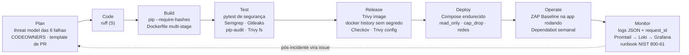
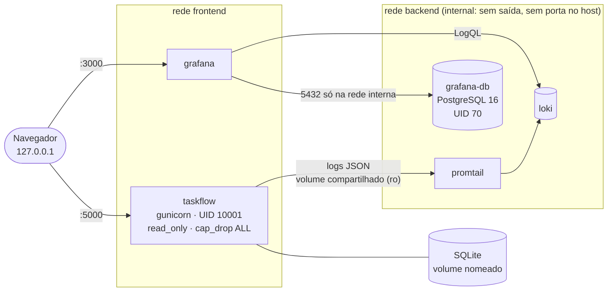
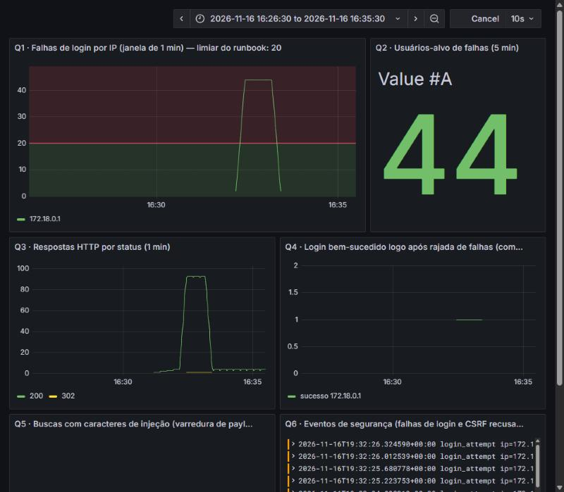

# TaskFlow — esteira segura, DAST, IaC e observabilidade

[](https://github.com/rafaelholder/taskflow-devsecops/actions/workflows/ci.yml)
[](https://github.com/rafaelholder/taskflow-devsecops/actions/workflows/sast.yml)
[](https://github.com/rafaelholder/taskflow-devsecops/actions/workflows/sca.yml)
[](https://github.com/rafaelholder/taskflow-devsecops/actions/workflows/hardening.yml)
[](https://github.com/rafaelholder/taskflow-devsecops/actions/workflows/dast.yml)
[](https://github.com/rafaelholder/taskflow-devsecops/actions/workflows/iac-scan.yml)

Lab final de **DevSecOps (CS031) — CESAR School, 2026.2**. A TaskFlow, aplicação Flask vulnerável de propósito, passa a ser protegida por uma esteira no GitHub Actions que **bloqueia o merge** quando o código, as dependências, a imagem, a aplicação em execução ou a infraestrutura têm problemas; o ambiente sobe por Compose endurecido; e um ataque de força bruta é detectado no Grafana e tratado por um runbook.

**Grupo:** Rafael Holder · Arthur Leandro · Maria Clara Miranda · André · Gabriel Peixoto · **Professores:** Cris Apolinário e Diego Buarque

O primeiro commit (`92e4193`) é a linha de base original da disciplina, intacta. Tudo depois dele é trabalho do grupo, então `git diff 92e4193` mostra exatamente o que mudou.

---

## 1. A esteira

Todos os workflows rodam em `pull_request` e `push` na `main`, têm `workflow_dispatch`, `permissions: contents: read` e **actions de terceiros fixadas por SHA de commit** (imagens por digest). Nenhum usa `continue-on-error`, `--exit-zero` ou `soft_fail`.

| Workflow | Job (= required check da `main`) | Gate: bloqueia o merge se… | Módulo |
|---|---|---|---|
| `ci.yml` | **Build, lint e testes** | dependência sem o hash esperado · `ruff check` (inclui regras de segurança `S`) · formatação · 11 testes de segurança falham | 1 |
| `sast.yml` | **SAST - Semgrep** | qualquer achado de `p/python`, `p/flask`, `p/security-audit` ou das 5 regras próprias (`.semgrep/taskflow.yml`) | 3 |
| `sast.yml` | **Secret scanning - Gitleaks** | segredo em **qualquer commit do histórico** (`fetch-depth: 0`) | 3 |
| `sca.yml` | **SCA - pip-audit** | CVE conhecida em dependência direta ou transitiva | 3 |
| `sca.yml` | **SCA - Trivy fs (segunda fonte)** | CVE HIGH/CRITICAL com correção, por outra base de dados | 3 |
| `hardening.yml` | **Build + Trivy + flags de runtime** | segredo em `ENV/ARG` nas camadas · `USER` ≠ `taskflow` · CVE HIGH/CRITICAL **com correção** na imagem · container não sobe com `--read-only --cap-drop=ALL --security-opt=no-new-privileges` | 2 |
| `dast.yml` | **ZAP Baseline contra a app no runner** | qualquer alerta do ZAP não rebaixado (com justificativa) em `.zap/rules.tsv` | 4 |
| `iac-scan.yml` | **IaC - Checkov (terraform + dockerfile + github_actions)** | falha do Checkov sem `checkov:skip` justificado | 5 |
| `iac-scan.yml` | **IaC - Trivy config (tfsec + compose + Dockerfile)** | configuração HIGH/CRITICAL | 5 |
| `iac-scan.yml` | **IaC - terraform validate** | Terraform inválido | 5 |

Fora do CI: **Dependabot** (pip, GitHub Actions e Docker, semanal), **CODEOWNERS** e template de PR.

**Proteção da `main`:** PR obrigatório; os 10 checks acima obrigatórios, com a branch atualizada antes do merge; a regra vale **também para administradores** (ninguém faz push direto); histórico linear; conversas resolvidas; sem force push e sem exclusão. Aprovação de revisor: 0 enquanto os demais integrantes não são colaboradores do repositório — com eles adicionados, sobe para 1 aprovação de code owner (`.github/CODEOWNERS`).

**Acesso do professor:** `@HardSource` foi convidado como colaborador. Em repositório pessoal o GitHub não oferece o nível *Read* (só organizações têm permissões granulares); a proteção acima impede qualquer alteração na `main` sem PR e checks verdes.

### Disparar cada workflow

Abrir um PR para a `main` dispara todos. Para rodar um isolado: **Actions → (workflow) → Run workflow**, ou `gh workflow run dast.yml`. O `sca.yml` também roda toda segunda-feira, porque CVE nova em dependência antiga aparece sem ninguém abrir PR.

> **Por que nenhum workflow usa filtro `paths:`** — os jobs são required checks. Um `iac-scan` que só rodasse quando um `.tf` muda deixaria todo PR de código travado esperando um check que nunca chega. Rodar sempre custa ~1 min por PR.

## 2. Onde cada ferramenta entra no S-SDLC



## 3. Arquitetura do ambiente (`docker-compose.yml`)



- Só `taskflow` e `grafana` publicam porta, e **só em `127.0.0.1`**. **Os bancos não têm porta no host:** o PostgreSQL do Grafana (`grafana-db`, que guarda usuários, sessões e dashboards) e o Loki (o banco de logs) ficam na rede `internal`, sem rota para fora. Só o Grafana, que está nas duas redes, alcança o PostgreSQL. Prova: `docker compose ps` lista `grafana-db` com `5432/tcp` **sem** mapeamento `127.0.0.1:…->` (porta só interna, como o `3100/tcp` do Loki), e `docker compose port grafana-db 5432` devolve `:0`, isto é, não publicada.
- Todos os serviços: `read_only`, `cap_drop: [ALL]`, `no-new-privileges`, limites de CPU e memória (e de PIDs na app), healthcheck e rotação de log.
- Segredos só no `.env` (fora do Git). O Compose **recusa subir** se `TASKFLOW_SECRET_KEY`, `GRAFANA_ADMIN_PASSWORD` ou `GRAFANA_DB_PASSWORD` faltarem.

```bash
cp .env.example .env        # preencha com valores aleatórios
docker compose up -d --build
# app: http://127.0.0.1:5000 (admin/admin123 ou aluno/senha123, usuários de LABORATÓRIO)
# grafana: http://127.0.0.1:3000 → TaskFlow → "TaskFlow - Segurança"
python scripts/forca_bruta.py --acertar   # simula o ataque (só aceita localhost)
```

## 4. Antes × depois (medido)

| Ferramenta | Linha de base | Agora | Evidência (`docs/evidencias/`) |
|---|---|---|---|
| **Trivy image** (HIGH/CRITICAL) | SO: **504 HIGH + 15 CRITICAL** · Python: 12 HIGH + 3 CRITICAL | **0 com correção disponível** (47 HIGH do Debian sem patch publicado) | `trivy-antes.txt`, `trivy-depois.txt` |
| **docker history** | `ENV ADMIN_PASSWORD=admin123` gravado na camada | nenhum segredo; `USER taskflow` | `docker-history-antes.txt`, `-depois.txt` |
| **Semgrep** | **10 achados** (SQLi ×2, XSS, SECRET_KEY, retorno de f-string, debug) | **0** (+ 5 regras próprias) | `semgrep-antes.txt`, `semgrep-depois.txt` |
| **Gitleaks** | **0** com as regras padrão — **a SECRET_KEY passava despercebida** | regra própria pega o literal; allowlist só para o commit didático | `.gitleaks.toml` |
| **pip-audit** | **51 vulnerabilidades em 5 pacotes** (Flask 0.12.2, Werkzeug 0.15.4…) | **0** | `pip-audit-antes.txt`, `-depois.txt` |
| **OWASP ZAP** | **8 WARN** | **0 WARN · 0 FAIL · 64 PASS** (3 IGNORE + 1 INFO justificados) | `zap/zap-antes.*`, `zap/zap-depois.*` |
| **Checkov (Terraform)** | `main.insecure.tf`: **16 falhas** | **0** (6 skips justificados na linha) | `checkov-antes.txt`, `checkov-depois.txt` |
| **Trivy config** | o próprio `main.fixed.tf` de referência deixava **egress 443 para 0.0.0.0/0** (CRITICAL) | **0** | `trivy-config.txt` |
| **Lynis** (container `ubuntu:22.04` do Encontro 3, Passos 0–6) | **3 Warnings** · índice 61 | **0 Warnings** ("Great, no warnings") · índice 62 · 234 testes nos dois | `lynis/lynis-antes.txt`, `lynis-depois.txt` · análise em **[docs/lynis-achados.md](docs/lynis-achados.md)** |

Provas de exploração na linha de base (rodando a versão original): `admin' --` no login entra **sem senha** (302 para `/tasks`); `/debug/info` devolve a página do **debugger interativo do Werkzeug**. Na versão atual: login recusado e `404`. E um bônus da FALHA 1: com `FROM python:latest` a imagem original **nem sobe mais** — o `latest` virou Python 3.15, incompatível com o Flask 0.12 (`falha1-python-latest-quebra.txt`).

### Os 8 alertas do ZAP, um a um

Linha de base: **2 Medium + 6 Low** (os 8 WARN) e 3 Informational (`zap/zap-antes.md`). Depois: nenhum Medium/Low; sobram só informativos, rebaixados com justificativa em `.zap/rules.tsv` (`zap/zap-depois.md`).

| # | Alerta (ID do ZAP) | Risco | CWE | OWASP Top 10 (2021) | Antes → depois | O que corrigiu |
|---|---|---|---|---|---|---|
| 1 | Content Security Policy não definida (10038) | Medium | 693 | **A05** Security Misconfiguration | 5 → **0** | `Content-Security-Policy: default-src 'self'; frame-ancestors 'none'; form-action 'self'; base-uri 'self'` |
| 2 | Falta cabeçalho anti-clickjacking (10020) | Medium | 1021 | **A05** (a CWE-1021 está listada em **A04** Insecure Design) | 3 → **0** | `X-Frame-Options: DENY` + `frame-ancestors 'none'` |
| 3 | Falta `X-Content-Type-Options` (10021) | Low | 693 | **A05** | 3 → **0** | `X-Content-Type-Options: nosniff` |
| 4 | Servidor vaza versão no `Server` (10036) | Low | 497 | **A05** (a CWE-497 está listada em **A01** Broken Access Control) | 5 → **0** | Werkzeug de desenvolvimento (`Werkzeug/0.15.4 Python/3.12.16`) trocado por gunicorn, que responde só `Server: gunicorn` |
| 5 | `Permissions-Policy` ausente (10063) | Low | 693 | **A05** | 5 → **0** | `Permissions-Policy: camera=(), microphone=(), geolocation=()` |
| 6 | Cross-Origin-Embedder-Policy ausente (90004) | Low | 693 | **A05** | 3 → **0** | `Cross-Origin-Embedder-Policy: require-corp` |
| 7 | Cross-Origin-Opener-Policy ausente (90004) | Low | 693 | **A05** | 3 → **0** | `Cross-Origin-Opener-Policy: same-origin` |
| 8 | Cross-Origin-Resource-Policy ausente (90004) | Low | 693 | **A05** | 3 → **0** | `Cross-Origin-Resource-Policy: same-origin` |
| i | Authentication Request Identified (10111) | Info | — | — (reconhecimento do formulário) | 1 → 1 | IGNORE justificado: não é falha |
| i | Storable and Cacheable Content / Non-Storable (10049) | Info | 524 | **A05** (diretiva de cache ausente) | cacheável 5 → **0** | `Cache-Control: no-store`; o "Non-Storable" que sobra é o próprio controle (IGNORE justificado) |

Critério da coluna OWASP: a descrição da A05 (2021) inclui explicitamente o servidor que não envia cabeçalhos ou diretivas de segurança; quando a lista oficial de CWEs da OWASP põe a CWE do alerta em outra categoria, ela aparece entre parênteses. Os cabeçalhos estão em `app.py` (`after_request`). Por que quase tudo cai em **A05**: o ZAP Baseline é **passivo** — ele só observa respostas, então enxerga configuração (cabeçalhos, banner), não injeção. **SQLi e XSS (A03)** não aparecem no relatório do ZAP nem antes nem depois; quem os prova e impede a volta são os testes (`tests/`), o Semgrep e a demonstração da seção 8. O DAST complementa o SAST, não o substitui.

## 5. As vulnerabilidades da TaskFlow, a correção e a prova

| # | Falha da linha de base | OWASP Top 10 (2021) | Correção | Quem impede a volta |
|---|---|---|---|---|
| 1 | SQL Injection no login e na busca | **A03** Injection | placeholders `?` | Semgrep (`tainted-sql-string` + `taskflow-sql-concatenado`), 2 testes |
| 2 | XSS armazenado na descrição; refletido em `q` e no erro do login | **A03** Injection | templates Jinja2 com autoescape, sem `\| safe`; CSP | regra `taskflow-template-safe-filter`, 2 testes, ZAP |
| 3 | `SECRET_KEY` no código | **A02** Cryptographic Failures · **A05** | variável obrigatória; a app não sobe sem ela | Gitleaks (regra própria), Semgrep |
| 4 | Senhas em texto puro | **A02** Cryptographic Failures | `generate_password_hash` (scrypt, com salt) | teste `test_senhas_guardadas_com_hash` |
| 5 | `/debug/info` e `debug=True` | **A05** Security Misconfiguration | rota removida; `FLASK_DEBUG` desligado por padrão; gunicorn | regra `taskflow-flask-debug-ligado`, teste, ZAP |
| 6 | Dependências com CVE | **A06** Vulnerable and Outdated Components | `requirements.in` → `requirements.txt` **com hashes**; PyYAML e requests removidos (não eram usados) | pip-audit, Trivy fs, Dependabot |
| — | Cabeçalhos ausentes, CSRF, cookie sem flags (achados do ZAP) | **A05** · **A01** | CSP, X-Frame-Options, nosniff, COOP/COEP/CORP, token CSRF sincronizador, cookie `HttpOnly`/`SameSite` | ZAP, 3 testes |
| — | Falhas 1–6 do Dockerfile | **A05** · **A08** Integrity | digest fixo, multi-stage, `--require-hashes`, UID 10001, sem `ENV` secreto, gunicorn, healthcheck | job de hardening |
| — | Sem logs de segurança | **A09** Logging & Monitoring Failures | JSON com `request_id`; eventos de login, tarefa, listagem e CSRF; nada sensível | teste `test_senha_nunca_vai_para_o_log`, regra `taskflow-formulario-inteiro-no-log` |

## 6. Observabilidade e resposta a incidente

Consultas LogQL do dashboard **TaskFlow - Segurança** (provisionado automaticamente):

| Pergunta | LogQL |
|---|---|
| **Q1** Quem está errando senha, e quanto? | `sum by (ip) (count_over_time({job="taskflow", event="login_attempt", result="failure"} \| json [1m]))` |
| **Q2** Quais contas estão sendo atacadas? | `sum by (username) (count_over_time({job="taskflow", event="login_attempt", result="failure"} \| json [5m]))` |
| **Q3** A aplicação está devolvendo erro? | `sum by (status_code) (count_over_time({job="taskflow", event="http_request"} \| json [1m]))` |
| **Q4** Alguém entrou depois da rajada? | `sum by (ip) (count_over_time({job="taskflow", event="login_attempt", result="success"} \| json [1m]))` |
| **Q5** Há varredura de payloads na busca? | `{job="taskflow", event="tasks_list_accessed"} \| json \| search=~".*(<\|>\|'\|--\|(?i)union\|(?i)select).*"` |

Runbook com condição de disparo, query de detecção e as quatro fases do NIST SP 800-61, já exercitado: **[docs/runbook-forca-bruta.md](docs/runbook-forca-bruta.md)**.

**Evidência do ataque detectado** (`scripts/forca_bruta.py --tentativas 45 --intervalo 0.2 --acertar`, 16/11/2026): Q1 sobe a **44 falhas em 1 minuto** vindas de um único IP, acima do limiar 20 do runbook; Q2 mostra a conta-alvo com 44 falhas; Q4 registra o **login bem-sucedido** do mesmo IP logo após a rajada — o sinal de comprometimento que aciona a contenção. A mesma contagem saiu da API do Loki em `docs/evidencias/incidente/deteccao-loki.txt`.



## 7. Decisões técnicas e trade-offs

1. **Trivy com `ignore-unfixed`.** A imagem base Debian tem 47 HIGH sem patch publicado. Bloquear por eles deixaria o gate permanentemente vermelho e, na prática, ignorado. O que **tem** correção bloqueia — foi assim que apareceu o CVE-2026-85091 do zlib, corrigido no Dockerfile com versão fixada até a imagem base ser atualizada.
2. **Sem rate limiting no `/login`, de propósito.** O Módulo 6 pede que a força bruta aconteça e seja detectada; limitar na aplicação esconderia o sinal. É a primeira ação pós-incidente do runbook.
3. **Rebaixamentos do ZAP só para o informativo.** 10049 é consequência do `Cache-Control: no-store` que nós mesmos colocamos; 10111 e 10112 são reconhecimento de formulário e de cookie. O 10031 ficou como INFO (aparece, não bloqueia) porque o valor refletido é o token CSRF do servidor. CSRF (10202) e COEP (90004) foram **corrigidos**, não ignorados.
4. **Gitleaks: allowlist por commit, não por regra.** O commit didático fica no histórico de propósito; a exceção é o hash dele, nunca a regra inteira.
5. **`hardening/` fora só do Trivy config.** O container do Lynis reproduz o ambiente do Encontro 3 e precisa de root para auditar o SO; no estágio `depois` ele recebe só `NET_ADMIN` para ativar o ufw dentro do próprio namespace de rede. O Checkov continua escaneando a pasta com skips justificados, e a imagem da aplicação segue obrigada a rodar como `taskflow`.
6. **Dependências mínimas.** PyYAML e requests saíram: não eram importados, e duas das cinco bibliotecas com CVE da linha de base eram elas.
7. **Grafana em PostgreSQL próprio, sem TLS interno.** O SQLite embutido do Grafana virou um `grafana-db` dedicado, sem porta no host e na rede `internal`. O tráfego Grafana → banco nunca sai dessa rede, por isso `sslmode=disable` neste lab; em produção seria `verify-full` com certificado.

## 8. Demonstração do shift-left

Branch `demo/sqli-regressao`: reintroduz uma query concatenada na busca. O PR fica com **SAST - Semgrep** vermelho e o merge bloqueado; o commit seguinte volta a usar `?` e tudo fica verde. Roteiro completo da apresentação: **[docs/roteiro-apresentacao.md](docs/roteiro-apresentacao.md)**.

## 9. Estrutura

```text
app.py · templates/           aplicação corrigida e instrumentada
Dockerfile · .dockerignore     imagem endurecida (Módulo 2)
requirements.in → .txt         dependências diretas → travadas com hashes
tests/                         11 testes de segurança (pytest)
.semgrep/taskflow.yml          5 regras próprias
.gitleaks.toml                 regra da SECRET_KEY + allowlist do commit didático
.zap/rules.tsv                 exceções do DAST, cada uma justificada
.github/workflows/             ci · sast · sca · hardening · dast · iac-scan
.github/dependabot.yml · CODEOWNERS · pull_request_template.md
docker-compose.yml · .env.example   app, Loki, Promtail, Grafana e o PostgreSQL do Grafana
observabilidade/               promtail + provisionamento do Grafana (datasource e dashboard)
infra/main.tf                  Terraform corrigido (validate + Checkov + Trivy config)
hardening/                     Encontro 3 (ubuntu:22.04, Passos 0–6) + Lynis antes × depois
scripts/forca_bruta.py         simulador de ataque (só localhost)
docs/                          runbook, roteiro, evidências antes × depois
```
